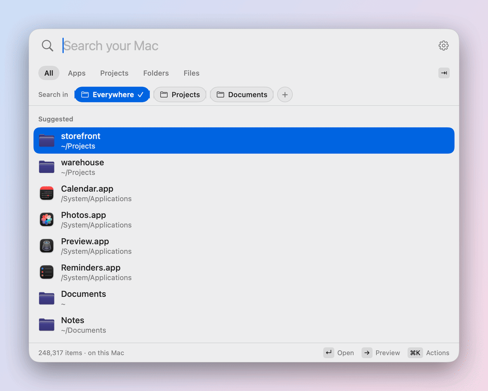

# Findling

**Find any file, folder, project or app on your Mac as you type.**

Findling is a fast, private launcher for the files on your Mac. Press **⇧⌘Space**, type a few letters and open what you need. It keeps its own index of your home folder, apps, iCloud Drive and cloud folders, so results appear instantly, and nothing ever leaves your Mac.

<picture>
  <source media="(prefers-color-scheme: dark)" srcset="docs/images/demo-dark.gif">
  
</picture>

## Features

- **Instant results** from a local index that stays current within seconds. On a million-item index most searches take under 50 ms.
- **Forgiving matching.** Letters in order find names (`qrep` → *Quarterly Report*), accents need not be typed (`calisma` → *Çalışma*), and apps and system folders are found by their names in your languages (`Kalender`, `Belgeler`).
- **Preview** with → or ⌘Y: Quick Look thumbnails, page counts, image sizes, dates, and Markdown rendered as headings, lists, tables and task lists.
- **Filters.** Tab through Apps, Projects, Folders and Files. Add your favourite folders to the **Search in** row.
- **Projects** are recognized by `.git`, `Package.swift`, `package.json`, `Cargo.toml`, `pyproject.toml` and `pubspec.yaml`.
- **Learns** which result you open for a query. Pin results you need often and hide the ones you never want.
- **Private.** No network access, no telemetry. Findling never moves or changes your files.
- Native SwiftUI and AppKit, light and dark, four theme colors, three text sizes. Apple silicon and Intel, macOS 14 or later.

## Install

1. Download `Findling-<version>.dmg` from the [latest release](https://github.com/mehambas/findling/releases/latest).
2. Open it and drag **Findling** to **Applications**.
3. Open Findling. Findling is not notarized by Apple (that needs a paid developer account), so macOS blocks the first launch:
   - macOS says it could not verify Findling. Click **Done**.
   - Open **System Settings › Privacy & Security**, scroll down to *“Findling” was blocked*, click **Open Anyway** and confirm.

   On macOS 14 you can instead Control-click Findling in Applications and choose **Open**. This is needed once per download.
4. Findling lives in the menu bar. Press **⇧⌘Space** to open it.

On the first launch Findling indexes your Mac in the background: a few minutes for a million items. You can search right away; results fill in as the index grows. macOS asks whether Findling may read your Desktop, Documents and Downloads folders. If you decline, those folders are skipped, and **Settings › Index** lists every folder Findling could not read.

To start Findling when you log in, turn on **Settings › General › Open at login**.

## Usage

| Shortcut | Action |
| --- | --- |
| ⇧⌘Space | Open or close Findling (change it in **Settings › General**) |
| ↑ / ↓ | Select a result |
| Return | Open |
| ⌘Return | Show in Finder |
| Tab / Shift-Tab | Next / previous type filter |
| → / ← at the end of the query | Open / close the preview |
| ⌘Y | Toggle the preview |
| ⌘K | Actions: open, show in Finder, pin, hide |
| ⌘P | Pin / unpin |
| ⇧Delete or ⌘Delete | Clear the search |
| ⌘, | Settings |
| Escape | Close the preview, then Findling |

Click a row to select it, double-click to open it, right-click for its actions.

**Settings** has four tabs:

- **General**: open at login, text size, theme color, the shortcut.
- **Locations**: the folders Findling indexes (home folder, Applications, iCloud Drive and cloud folders by default) and the folder buttons in the **Search in** row.
- **Exclusions**: folders to leave out, the build output, dependencies and caches Findling skips on its own, and results you have hidden.
- **Index**: item count, size on disk, folders Findling could not read, and **Refresh Now**.

## Privacy

- Findling has no networking code and sends nothing anywhere.
- It searches names and paths, not file contents. The preview reads the selected file only while it is shown and stores nothing.
- The index is an SQLite database in `~/Library/Application Support/Findling`. Settings, pins and learned choices are in `~/Library/Preferences/com.hamzabasaran.findling.plist`.

## Uninstall

1. If **Open at login** is on, turn it off in **Settings › General**.
2. Quit Findling from its menu bar icon and move `/Applications/Findling.app` to the Trash.
3. Remove its index, settings and folder permissions:

   ```sh
   rm -rf ~/Library/Application\ Support/Findling
   defaults delete com.hamzabasaran.findling
   tccutil reset All com.hamzabasaran.findling
   ```

## Build from source

You need macOS 14 or later and Xcode 16 or the Swift 6 command line tools. There are no other dependencies.

```sh
git clone https://github.com/mehambas/findling.git
cd findling
swift test --disable-sandbox -c release
bash scripts/build.sh
open dist/Findling.app
```

`scripts/build.sh` builds a universal app. It is signed ad hoc, so macOS asks for folder access again after each rebuild; see [How Findling works](docs/how-it-works.md#development) for a stable signature, the visual check and the release script.

## Support

Findling is free and open source. If it saves you time, you can [buy me a coffee on Ko-fi](https://ko-fi.com/mehambas91) ☕

Found a bug or have an idea? [Open an issue](https://github.com/mehambas/findling/issues).

## License

[MIT](LICENSE)
